# Week 3 Cybersecurity Internship Report
## Password Cracking with John the Ripper and Networkwalks Tools

**Internship:** Networkwalks Cybersecurity Internship  
**Week:** 3  
**Focus area:** Password-protected PDF analysis and password recovery  
**Tools used:** Networkwalks Hash Calculator, Networkwalks Password Cracker, John the Ripper (JtR), Johnny GUI, PDF hash extraction utility

---

## 1. Overview

During Week 3, I worked on password recovery exercises involving encrypted PDF documents. The practical work focused on extracting PDF password hashes, understanding the hash format, and using two different approaches to recover the passwords:

1. **Networkwalks web tools** — used for `My-Locked-Pdf-1.pdf`.
2. **John the Ripper with Johnny GUI** — used for the additional PDF samples shown in the evidence.

The exercises helped me understand how password-protected documents can be assessed in an authorized lab environment and how dictionary-based password recovery works.

> **Authorization note:** These techniques were used only on the internship-provided practice files and within the scope of the assigned exercise. Do not upload or test documents unless you own them or have explicit permission.

## 2. Objectives

- Understand the difference between encryption and hashing.
- Extract a cracking-compatible hash from a password-protected PDF.
- Identify the PDF hash format used by the tools.
- Recover passwords using the Networkwalks online tools.
- Recover passwords using John the Ripper and its Johnny graphical interface.
- Verify recovered passwords by opening the corresponding protected PDF.
- Compare a browser-based workflow with a local password-auditing workflow.

## 3. Concepts

### Encryption vs. hashing

- **Encryption** is reversible when the correct key is available. It protects the document contents.
- **Hashing** is a one-way transformation that produces a fixed-format digest. A hash is not normally reversed directly. Password recovery tools test candidate passwords and compare the resulting calculations with the extracted hash.

For a protected PDF, the extraction utility produces a PDF-specific hash representation (shown in the evidence with a `$pdf$` prefix). A cracking tool can use that representation to test candidate passwords.

### Dictionary attack

A dictionary attack tests candidate passwords from a wordlist rather than trying every possible character combination. If a password is common or appears in the selected wordlist, it may be recovered quickly. A successful result demonstrates why weak and reused passwords are risky.

## 4. Work Performed

### Task A — Networkwalks Hash Calculator and Password Cracker

**Target:** `My-Locked-Pdf-1.pdf`  
**Tools:** Networkwalks Hash Calculator and Networkwalks Password Cracker

#### Procedure

1. Opened the Networkwalks Hash Calculator in a browser.
2. Selected the internship-provided password-protected PDF.
3. Extracted the PDF hash in a format compatible with PDF password-auditing tools.
4. Copied the extracted hash into the Networkwalks Password Cracker.
5. Started the cracking process and monitored the candidate attempts.
6. The tool reported a successful match.
7. Used the recovered password to unlock the practice PDF.

#### Result

**Status:** Successful  
**Recovered password:** `password1`

#### Evidence

| Stage | Screenshot |
|---|---|
| Hash extraction in Networkwalks Hash Calculator | 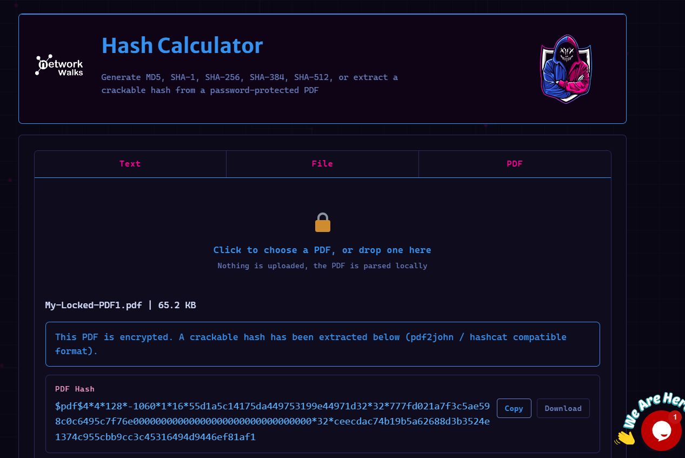 |
| Password Cracker reports a match | 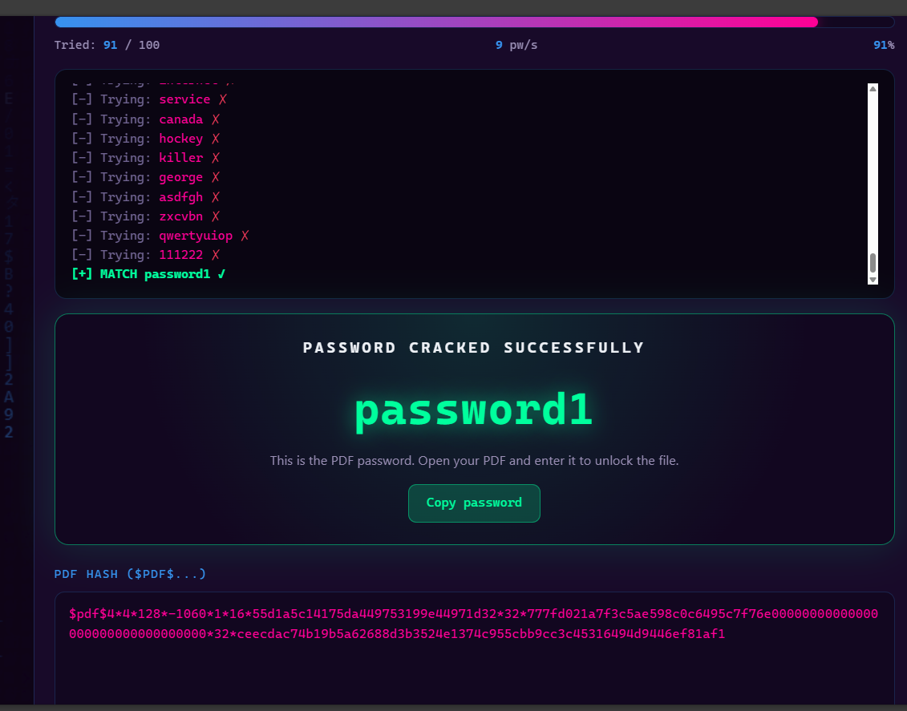 |
| Internship flag / completion confirmation | 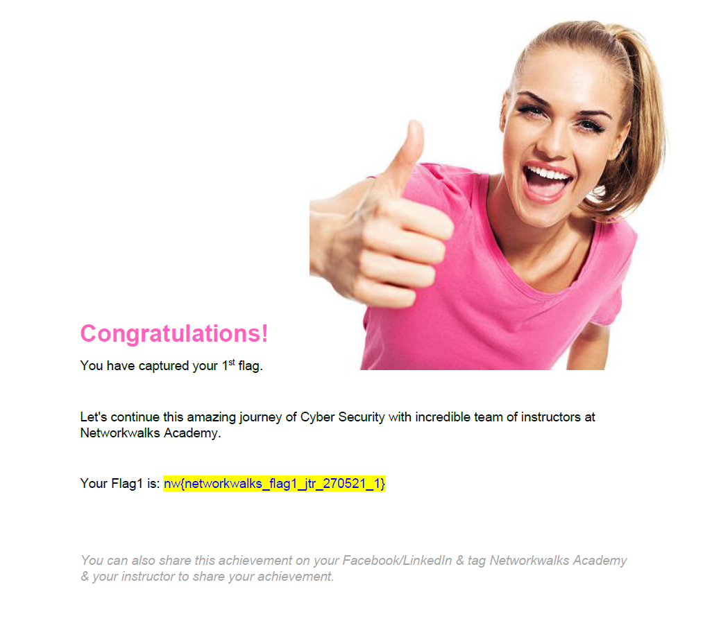 |

### Task B — Password recovery using John the Ripper and Johnny GUI

**Tools:** John the Ripper and Johnny GUI  
**Method:** Extract the PDF hash, load it into Johnny, and run the password-auditing attack.

#### Procedure

1. Extracted the PDF hash from each assigned practice PDF using a PDF hash extraction utility.
2. Checked that the extracted text used the expected PDF hash format (beginning with `$pdf$`).
3. Saved or supplied the extracted hash in a text file for John the Ripper.
4. Opened Johnny and loaded the hash file using **Open password file**.
5. Started a new attack.
6. Monitored the attack progress and checked the password result shown by Johnny.
7. Verified the recovered password against the corresponding practice PDF.

#### Results

The supplied Johnny screenshots show successful recovery for the three PDF samples:

| Practice sample | Result shown in Johnny | Status |
|---|---|---|
| My Locked PDF 1 (John the Ripper evidence set) | `good-luck` | Cracked |
| My Locked PDF 2 | `password1` | Cracked |
| My Locked PDF 3 | `1qaz2wsx` | Cracked |

**Important distinction:** The first Networkwalks exercise above is the separately documented `My-Locked-Pdf-1.pdf` workflow and returned `password1`. The John the Ripper screenshots are retained as a separate evidence set, using the labels shown in the supplied screenshot filenames. This avoids treating the two tool workflows as one run.

#### John the Ripper evidence — PDF 1

**Hash extraction**

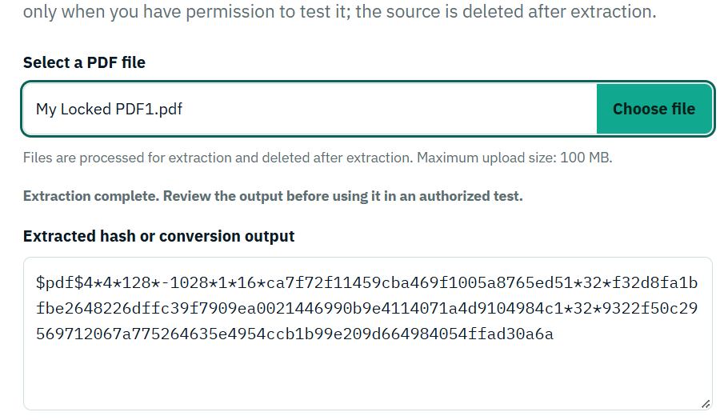

**Johnny result**

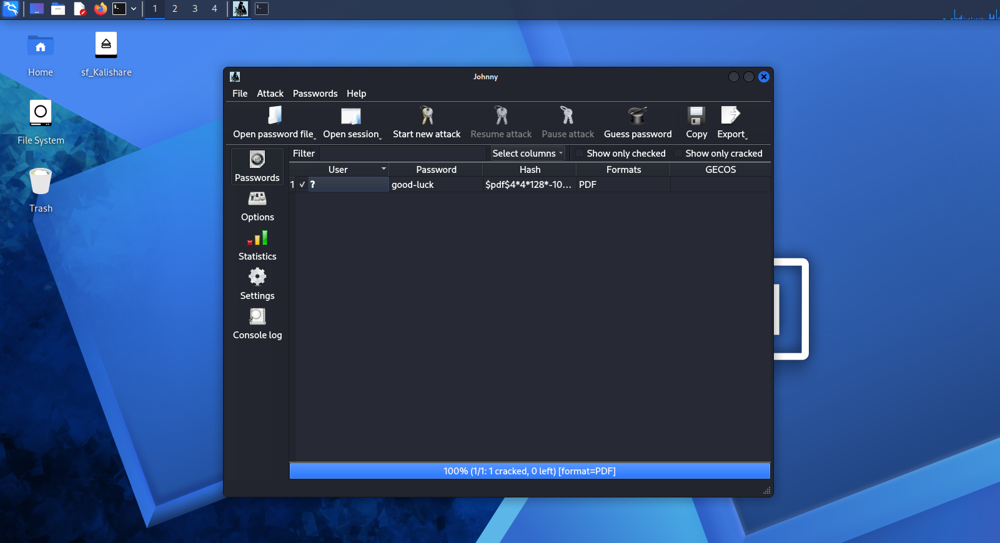

**Completion confirmation**

#### John the Ripper evidence — PDF 2

**Hash extraction**

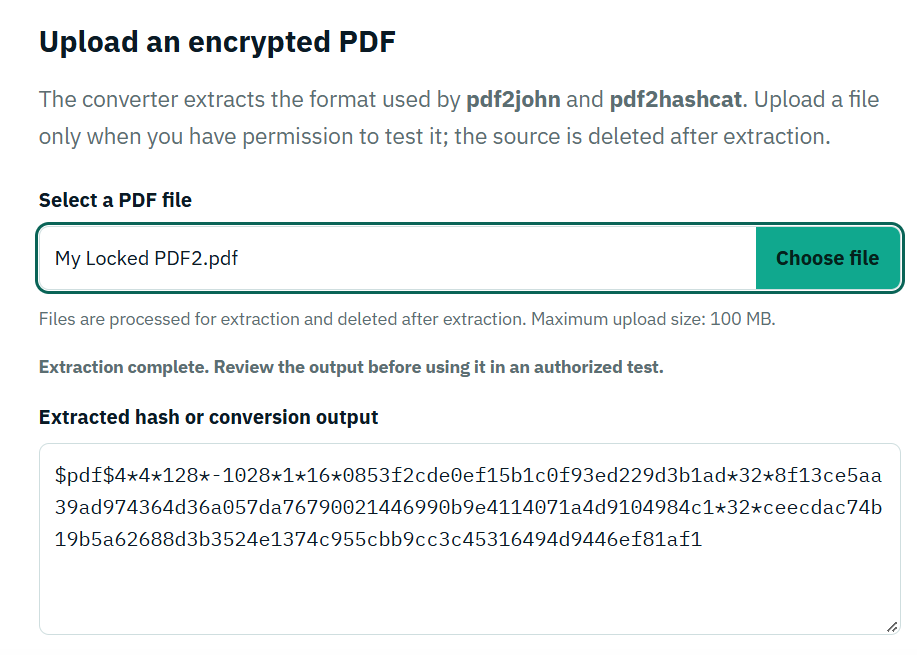

**Johnny result**

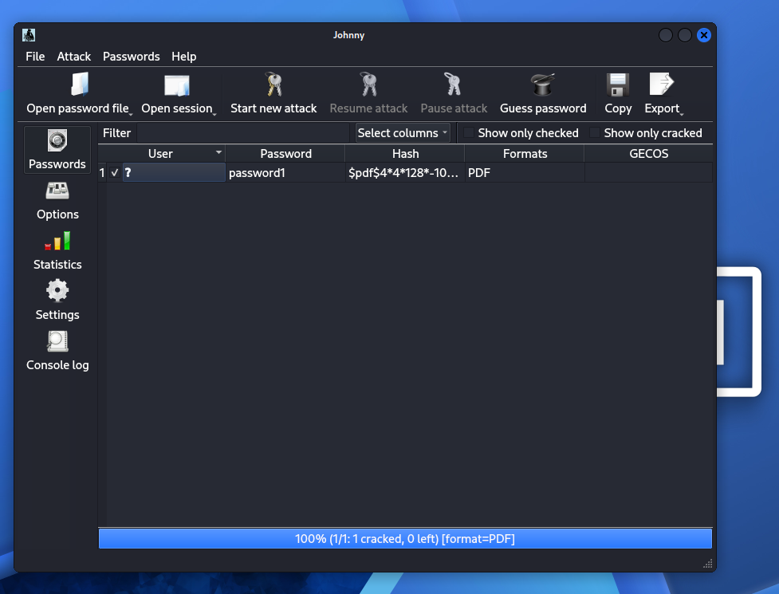

**Completion confirmation**

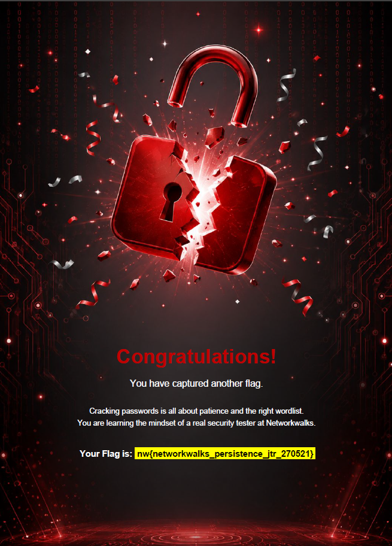

#### John the Ripper evidence — PDF 3

**Hash extraction**

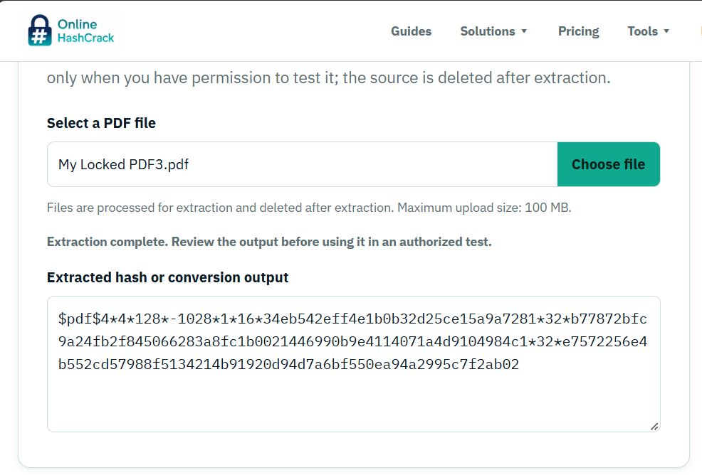

**Johnny result**

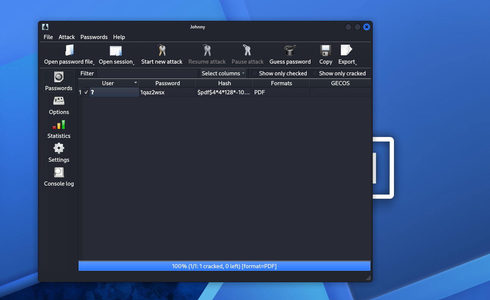

**Completion confirmation**

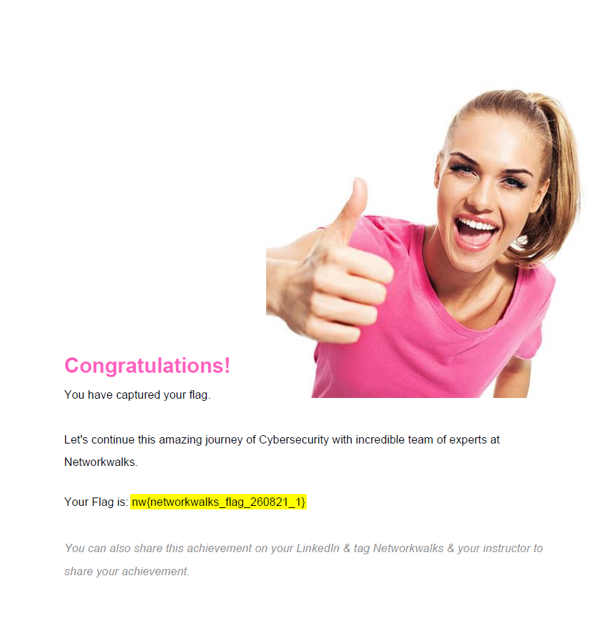

## 5. Tool Comparison

| Feature | Networkwalks web tools | John the Ripper / Johnny |
|---|---|---|
| Interface | Browser-based | Local command-line engine with GUI option |
| Installation | No local cracking-tool installation required for the web workflow | John the Ripper must be installed; Johnny provides a graphical interface |
| Hash input | Paste the extracted hash into the web cracker | Load a hash file into Johnny / John the Ripper |
| Configuration | Depends on the web tool's available options | More control over local wordlists and attack configuration |
| Useful for | A quick browser-based lab exercise | Local password auditing and configurable testing |

## 6. Key Learnings

- A protected PDF can expose a structured hash representation for offline password auditing without revealing the password itself.
- Hash extraction and password recovery are separate stages.
- A cracking tool tests candidate passwords; it does not mathematically reverse a one-way hash.
- Dictionary-based attacks can recover weak or commonly used passwords.
- John the Ripper can be used through the command line, while Johnny makes common operations accessible through a GUI.
- Browser-based tools and locally installed tools provide different levels of setup and configuration.
- A recovered password should be validated by opening the corresponding file, not only by relying on a tool's status message.

## 7. Security Recommendations

1. Use long, unique passphrases rather than short or predictable words.
2. Avoid common passwords, keyboard patterns, and simple number substitutions.
3. Do not reuse passwords across documents or accounts.
4. Protect sensitive files with strong encryption and securely share the password through a separate channel.
5. Use multi-factor authentication for accounts and services that support it.
6. Perform password audits only with explicit authorization and protect any recovered credentials as sensitive information.

## 8. Conclusion

Week 3 provided practical experience with password-protected PDF auditing. I extracted PDF hashes, used the Networkwalks web-based tools to recover the password for the first assigned file, and used John the Ripper with Johnny GUI for the additional PDF samples. The exercises reinforced the importance of strong passwords and demonstrated how dictionary-based recovery can expose weak credentials.

---

## 9. Repository Evidence

All screenshots used in this report are stored in the [`screenshots/`](screenshots/) directory. The images are embedded above so they can be reviewed directly from the GitHub README.

**Disclaimer:** This report documents an authorized educational exercise using internship-provided practice files. It is not an endorsement of accessing, cracking, or attempting to recover passwords from files without the owner's permission.

## Author

**Sanvir Kaur**

Cybersecurity & Blockchain | B.Tech CSE  
Lovely Professional University

**GitHub:** [14mSana](https://github.com/14mSana)  
**LinkedIn:** [Sanvir Kaur](https://www.linkedin.com/in/sanvir-kaur-86968739b/)  
**TryHackMe:** [sanvir](https://tryhackme.com/p/sanvir)

*Cybersecurity enthusiast passionate about ethical hacking, network security, and continuous learning.*
